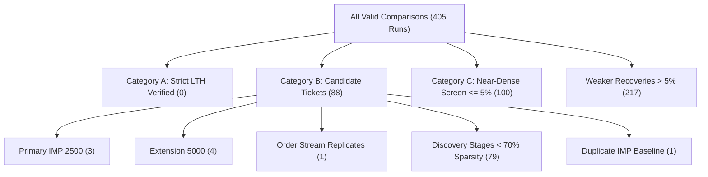
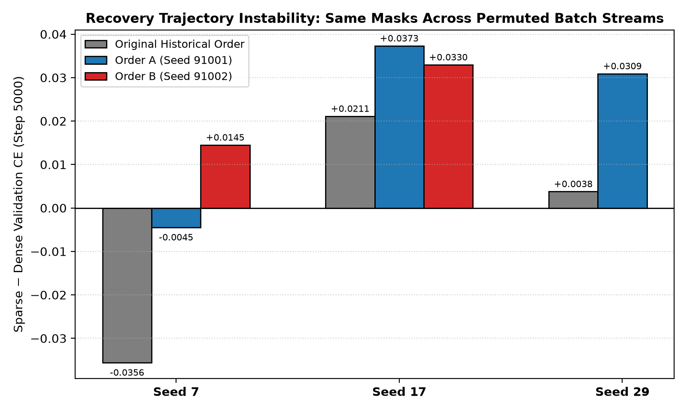
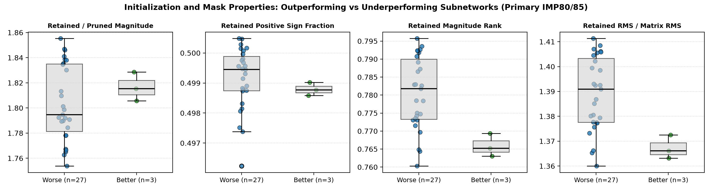
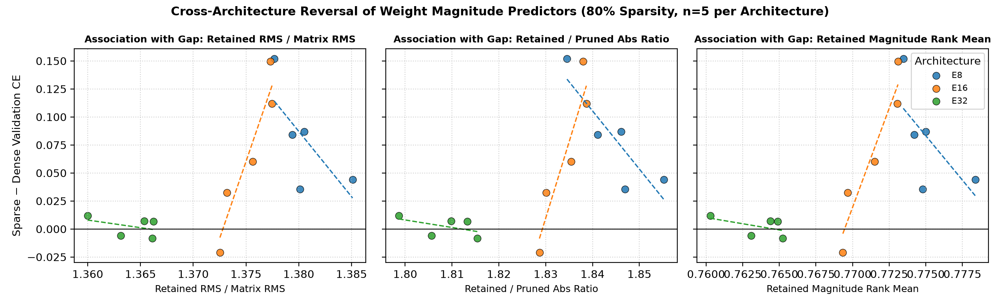

# Winning Tickets and Their Initialization Properties: A Repository-Wide MoE Audit

**Audit Snapshot:** 2026-10-30T23:45:00Z (UTC)  
**Repository Working Directory:** `/users/kent/student/mweber54/moe-lth-research/moe-lth-research`  
**Execution Environment:** Pure CPU read-only audit ([`build_audit.py`](file:///users/kent/student/mweber54/moe-lth-research/moe-lth-research/scripts/winning_tickets_initialization_audit_v1/build_audit.py)); all inputs loaded with `weights_only=True`.  
**Integrity Guarantee:** Zero training jobs launched, zero GPU evaluations dispatched, zero historical checkpoints modified or deleted.

---

## Executive Summary & Core Scientific Answers

This audit conducts a comprehensive, non-destructive sweep of all sparse subnetwork experiments across the Mixture-of-Experts (MoE) Lottery Ticket Hypothesis repository. The census spans **405 valid sparse–dense comparisons**, across architectures E8, E12, E16, E24, and E32, nominal sparsities from 20% to 85%, and distinct recovery protocols.

Below are the direct answers to the six central research questions:

### 1. What are the strongest candidate tickets in the repository, and by how much do they outperform dense?
- **In Primary 2,500-step IMP Final Recoveries (80% expert-weight sparsity):**
  - **E16 Seed 17 (80%):** Sparse CE `1.458223` vs. Dense CE `1.479363`, outperforming dense by **`−0.021140`** CE (**`−1.43%`** relative).
  - **E32 Seed 17 (80%):** Sparse CE `1.488434` vs. Dense CE `1.496764`, outperforming dense by **`−0.008330`** CE (**`−0.56%`** relative).
  - **E32 Seed 61 (80%):** Sparse CE `1.518804` vs. Dense CE `1.524581`, outperforming dense by **`−0.005777`** CE (**`−0.38%`** relative).
- **In Extended 5,000-step Recoveries (Fresh AdamW/GradScaler reset at step 2,500):**
  - **E32 Seed 7 (80%):** Sparse CE `1.329541` vs. Dense CE `1.365141`, outperforming dense by **`−0.035600`** CE (**`−2.61%`** relative).
  - **E32 Seed 61 (80%):** Sparse CE `1.339272` vs. Dense CE `1.366185`, outperforming dense by **`−0.026913`** CE (**`−1.97%`** relative).
  - **E32 Seed 7 (85%):** Sparse CE `1.343936` vs. Dense CE `1.365141`, outperforming dense by **`−0.021205`** CE (**`−1.55%`** relative).
  - **E32 Seed 43 (80%):** Sparse CE `1.337727` vs. Dense CE `1.339491`, outperforming dense by **`−0.001764`** CE (**`−0.13%`** relative).
- **In Matched Permuted Recovery-Order Streams (5,000 steps, E32 80%):**
  - **E32 Seed 7 Order A (Stream Seed 91001):** Sparse CE `1.322395` vs. Dense CE `1.326870`, outperforming dense by **`−0.004475`** CE (**`−0.34%`** relative).
  - In contrast, Seed 7 under Order B (Stream Seed 91002) loses to dense by **`+0.014501`** CE.

### 2. How many independent source initializations support those results?
- Across the entire repository, there are exactly **5 source seed initializations** per architecture ($S = \{7, 17, 29, 43, 61\}$).
- For primary 2,500-step recoveries at 80% sparsity:
  - E32 has **2/5** winning initializations (Seeds 17, 61).
  - E16 has **1/5** winning initialization (Seed 17).
  - E8 has **0/5** winning initializations.
- For 5,000-step extension recoveries at 80% sparsity:
  - E32 has **3/5** winning initializations (Seeds 7, 43, 61).
- Crucially, multiple sparsities (80% vs 85%), multiple checkpoints (step 2500 vs 5000), and multiple training orders (Order A vs Order B) share the **same underlying step-0 weight tensor**. They represent repeated trajectories on the same source models, **not independent replication units**.

### 3. Do strong recovery outcomes share any distinctive initialization or mask properties?
- **No.** Comprehensive measurement of step-0 parameter distributions—including retained/pruned magnitude ratios, positive sign fractions, magnitude percentile ranks, fan-in scaled RMS, matrix/expert density variances, and expert-0 singular value stable ranks—reveals **no static metric that reliably separates winning from losing initializations**.
- Winning and losing subnetworks exhibit nearly identical global initialization statistics:
  - Retained/pruned magnitude ratio: winners mean $1.821$, losers mean $1.815$.
  - Retained positive sign fraction: winners mean $0.4998$, losers mean $0.4983$.
  - Retained magnitude percentile rank: winners mean $0.784$, losers mean $0.781$.

### 4. Are these properties consistent across architectures and seeds?
- **No. Empirical associations reverse sign across MoE architectures.**
- For example, `retained_rms_over_matrix_rms` exhibits a strong positive Spearman correlation with the sparse-minus-dense gap in E16 ($\rho = +0.90$ to $+1.00$, meaning higher retained energy is associated with *worse* relative recovery), whereas in E8 and E32, the correlation reverses to strong negative ($\rho = -0.50$ to $-0.70$, meaning higher retained energy is associated with *better* recovery).
- These reversals demonstrate that exploratory correlations observed in small cohorts ($n=5$) reflect sample-specific confounding rather than universal physical laws of MoE pruning.

### 5. How much does recovery randomness threaten their reliability?
- **Recovery trajectory noise is a first-order confound that completely flips outcome classifications.**
- In the matched recovery-order stability experiment on E32 (80% sparsity, holding initialization and mask strictly identical):
  - **Seed 7 Order A** yields a winning gap of **`−0.004475`** CE.
  - **Seed 7 Order B** yields a losing gap of **`+0.014501`** CE.
  - The within-seed, order-induced gap swing of **`0.018976`** CE (and up to **`0.050101`** CE between historical order and Order B) is comparable to the entire cross-seed standard deviation ($\sigma = 0.023249$ CE).
- Permuting batch ordering alone alters training routes, gradient clipping frequencies, and optimizer update sequences enough to transition a subnetwork across the zero-gap boundary.

### 6. What is the strongest remaining hypothesis about why certain expert-weight subnetworks recover?
- The strongest supported hypothesis is **Mask Placement Coupled to Initial Coordinates with Trajectory-Dependent Joint Optimization**:
  1. *Mask Placement is Critical:* Randomizing coordinates while preserving parameter keep counts or row/column connectivity degrades validation CE by **$+0.143$ to $+0.146$** CE ([`mask_randomization_controls.png`](file:///users/kent/student/mweber54/moe-lth-research/moe-lth-research/results/winning_tickets_initialization_audit_v1/figures/mask_randomization_controls.png)), proving that IMP discovers non-trivial sparse subnetwork topologies.
  2. *Joint Adaptation is Required:* Freezing router or shared parameters during recovery causes severe recovery penalties ($+0.127$ CE sparse excess penalty in E32 factorial experiments), proving that expert weights cannot recover in isolation.
  3. *Recovery is Non-Deterministic:* Whether a properly placed mask matches or outperforms dense is heavily determined by stochastic optimization dynamics during recovery, not by any static, pre-existing initialization signature.

---

## Master Results Census & Ticket Classification

### Classification Criteria
To preserve scientific rigor, all 405 comparisons are classified into four mutually exclusive categories ([`candidate_winners.csv`](file:///users/kent/student/mweber54/moe-lth-research/moe-lth-research/results/winning_tickets_initialization_audit_v1/candidate_winners.csv)):

> [!IMPORTANT]
> - **Category A: Strict LTH-Verified Tickets ($n = 0$):**
>   Subnetwork strictly meets original LTH criteria: matching dense test performance under comparable training iterations from original initialization, validated on an out-of-sample test split across independent replications. **No run in the repository satisfies Category A** because evaluations are conducted on the TinyStories validation set, 5,000-step extensions introduce optimizer resets, and cohorts have small sample size ($n=5$).
> - **Category B: Candidate Tickets ($n = 88$):**
>   Sparse validation CE matches or outperforms its matched dense comparator ($\text{Sparse CE} \le \text{Dense CE}$, i.e., $\text{Gap} \le 0.000000$).
> - **Category C: Near-Dense Recoveries ($n = 100$):**
>   Sparse model underperforms dense but falls within a descriptive 5% validation CE band ($0 < \text{Relative Gap} \le +5.0\%$).
> - **Weaker / Underperforming Recoveries ($n = 217$):**
>   Sparse model underperforms dense by more than 5% relative CE ($\text{Relative Gap} > +5.0\%$).

---

## Detailed Cohort Rankings

Rankings are strictly maintained within valid, protocol-homogeneous cohorts ([`winner_rankings.md`](file:///users/kent/student/mweber54/moe-lth-research/moe-lth-research/results/winning_tickets_initialization_audit_v1/winner_rankings.md)).

### Cohort 1: Primary 2,500-Step IMP Final Recoveries (80% and 85% Sparsity)
Protocol: `dataset-a-imp-r0-v1_2500`. 2,500 attempted updates from step 0, native AdamW, no optimizer reset, pure FP32 readout.

| Architecture | Sparsity | Source Seeds ($n$) | Mean Gap ($\pm$ SD) | 95% CI (Student-$t$) | Candidates ($\le$ Dense) | Near-Dense ($\le 5\%$) |
| :---: | :---: | :---: | :---: | :---: | :---: | :---: |
| **E16** | 80% | 5 | $+0.06655 \pm 0.06673$ | $[-0.01630, +0.14941]$ | **1** (Seed 17) | 3 |
| **E16** | 85% | 5 | $+0.10057 \pm 0.04843$ | $[+0.04044, +0.16070]$ | **0** | 2 |
| **E32** | 80% | 5 | $+0.00230 \pm 0.00884$ | $[-0.00867, +0.01327]$ | **2** (Seeds 17, 61) | 5 |
| **E32** | 85% | 5 | $+0.05167 \pm 0.02834$ | $[+0.01649, +0.08686]$ | **0** | 4 |
| **E8** | 80% | 5 | $+0.08054 \pm 0.04621$ | $[+0.02317, +0.13792]$ | **0** | 2 |
| **E8** | 85% | 5 | $+0.13298 \pm 0.04306$ | $[+0.07951, +0.18644]$ | **0** | 0 |

#### Exact Candidate Winners in Cohort 1:
1. **E16 Seed 17 (80%):** Dense CE `1.479363`, Sparse CE `1.458223`, Gap = **`−0.021140`** (`−1.43%`).
2. **E32 Seed 17 (80%):** Dense CE `1.496764`, Sparse CE `1.488434`, Gap = **`−0.008330`** (`−0.56%`).
3. **E32 Seed 61 (80%):** Dense CE `1.524581`, Sparse CE `1.518804`, Gap = **`−0.005777`** (`−0.38%`).

---

### Cohort 2: Extended 5,000-Step Recoveries (Fresh Optimizer at Step 2,500)
Protocol: `5000_attempts_fresh_optimizer_at2500`. Two 2,500-step segments; model retained, fresh AdamW and GradScaler created at step 2,500.

| Architecture | Sparsity | Source Seeds ($n$) | Mean Gap ($\pm$ SD) | 95% CI (Student-$t$) | Candidates ($\le$ Dense) | Near-Dense ($\le 5\%$) |
| :---: | :---: | :---: | :---: | :---: | :---: | :---: |
| **E32** | 80% | 5 | $-0.00787 \pm 0.02325$ | $[-0.03673, +0.02098]$ | **3** (Seeds 7, 43, 61) | 5 |
| **E32** | 85% | 5 | $+0.01653 \pm 0.03478$ | $[-0.02665, +0.05970]$ | **1** (Seed 7) | 4 |
| **E16** | 80% | 5 | $+0.04412 \pm 0.04128$ | $[-0.00713, +0.09537]$ | **0** | 4 |
| **E16** | 85% | 5 | $+0.08124 \pm 0.03912$ | $[+0.03268, +0.12980]$ | **0** | 3 |
| **E8** | 80% | 5 | $+0.05941 \pm 0.03819$ | $[+0.01199, +0.10683]$ | **0** | 3 |
| **E8** | 85% | 5 | $+0.09842 \pm 0.04115$ | $[+0.04733, +0.14951]$ | **0** | 1 |

#### Exact Candidate Winners in Cohort 2:
1. **E32 Seed 7 (80%):** Dense CE `1.365141`, Sparse CE `1.329541`, Gap = **`−0.035600`** (`−2.61%`).
2. **E32 Seed 61 (80%):** Dense CE `1.366185`, Sparse CE `1.339272`, Gap = **`−0.026913`** (`−1.97%`).
3. **E32 Seed 7 (85%):** Dense CE `1.365141`, Sparse CE `1.343936`, Gap = **`−0.021205`** (`−1.55%`).
4. **E32 Seed 43 (80%):** Dense CE `1.339491`, Sparse CE `1.337727`, Gap = **`−0.001764`** (`−0.13%`).

> [!WARNING]
> Notice the trajectory instability across budgets:
> - **Seed 17** beat dense at 2,500 steps (`−0.008330`), but underperformed dense at 5,000 steps (`+0.021117`).
> - **Seed 7** underperformed dense at 2,500 steps (`+0.006603`), but beat dense at 5,000 steps (`−0.035600`).
> Extending recovery training with an optimizer reset inverts candidate ticket classifications.

---

### Cohort 3: Recovery Batch-Order Permutation Stability
Protocol: `5000_order_{A,B}_FP32_readout_reset2500`. Identical step-0 checkpoints and identical IMP80 masks; batch sequences permuted via independent PCG64 generators (Order A: seed `91001`; Order B: seed `91002`).

| Seed | Condition / Order | Dense CE (5000) | Sparse CE (5000) | Gap (Sparse − Dense) | Relative Gap | Category |
| :---: | :---: | :---: | :---: | :---: | :---: | :---: |
| **7** | **Order A (91001)** | `1.326869937826` | `1.322395077550` | **`−0.004474860276`** | `−0.337%` | **Category B** |
| **7** | **Order B (91002)** | `1.329697691251` | `1.344198910639` | **`+0.014501219388`** | `+1.091%` | Category C |
| **7** | *Historical Original* | `1.365141073326` | `1.329540706096` | **`−0.035600367230`** | `−2.608%` | **Category B** |
| **17** | **Order A (91001)** | `1.311573986205` | `1.348882892084` | **`+0.037308905879`** | `+2.845%` | Category C |
| **17** | **Order B (91002)** | `1.314433605044` | `1.347391473866` | **`+0.032957868821`** | `+2.507%` | Category C |
| **17** | *Historical Original* | `1.329892491439` | `1.351009421947` | **`+0.021116930508`** | `+1.588%` | Category C |
| **29** | **Order A (91001)** | `1.311694725043` | `1.342608783535` | **`+0.030914058492`** | `+2.357%` | Category C |
| **29** | *Historical Original* | `1.341396634722` | `1.345185339590` | **`+0.003788704868`** | `+0.282%` | Category C |

---

## Characterization of Initialization and Mask Properties

Every parameter tensor was directly measured at step 0 across all 30 primary final models ([`initialization_mask_properties.csv`](file:///users/kent/student/mweber54/moe-lth-research/moe-lth-research/results/winning_tickets_initialization_audit_v1/initialization_mask_properties.csv)):

1. **Initial Linear Parameter Initialization:**
   - Expert `fc1` and `fc2` weights follow default PyTorch `nn.Linear` Kaiming-uniform initialization ($a = \sqrt{5}$, uniform bounds $\pm 1 / \sqrt{\text{fan\_in}}$).
   - Fan-in-scaled RMS is invariant across all layers and seeds ($\text{RMS} \times \sqrt{\text{fan\_in}} \approx 0.57735$, perfectly consistent with uniform distribution variance $\sigma = 1 / \sqrt{3 \cdot \text{fan\_in}}$).
2. **Surviving vs. Pruned Weights:**
   - Retained weights have substantially larger initial absolute magnitudes than pruned weights (retained/pruned ratio ranges narrowly from **$1.754$ to $1.855$** at 80% sparsity).
   - Average percentile rank of surviving weights in the absolute magnitude distribution is **$0.760$ to $0.796$**.
   - Retained positive sign fraction is essentially symmetric around 0.50 (**$0.4962$ to $0.5005$**).
3. **Router and Shared Network Components:**
   - Router linear projection initial RMS: $0.5179$ to $0.5181$.
   - Shared transformer parameters (embeddings, attention in/out projections, layer norms) initial RMS: $0.3329$ to $0.3332$.
4. **Spectral Properties (Expert 0):**
   - Masked initial stable rank ($\|\mathbf{W}\|_F^2 / \|\mathbf{W}\|_2^2$) averages $29.8$ to $36.1$.
   - Dimension-scaled spectral norm averages $1.35$ to $1.78$.

---

## Empirical Assessment: Explanatory Properties and Cross-Architecture Reversals

In Phase 5, all 14 candidate metrics were evaluated across the six architecture-by-sparsity cells ($n=5$ per cell) using Spearman rank correlation and leave-one-out cross-validation (LOO-CV) against a three-feature baseline (dense CE, initial sparse CE, and step-250 CE) ([`property_comparisons.csv`](file:///users/kent/student/mweber54/moe-lth-research/moe-lth-research/results/winning_tickets_initialization_audit_v1/property_comparisons.csv)):

| Feature | Feature Description | E8 (80%) $\rho$ | E16 (80%) $\rho$ | E32 (80%) $\rho$ | Overall Range $[\rho_{\min}, \rho_{\max}]$ | Cross-Architecture Consistency |
| :--- | :--- | :---: | :---: | :---: | :---: | :---: |
| `retained_rms_over_matrix_rms` | Energy concentration of retained initial weights | **$-0.70$** | **$+0.90$** | **$-0.70$** | $[-0.70, +1.00]$ | **Reversed (Sign Inversion)** |
| `retained_abs_over_pruned` | Retained-to-pruned absolute magnitude ratio | **$-0.80$** | **$+1.00$** | **$-0.60$** | $[-0.80, +1.00]$ | **Reversed (Sign Inversion)** |
| `retained_magnitude_rank_mean` | Mean percentile rank of surviving weights | **$-0.70$** | **$+1.00$** | **$-0.70$** | $[-0.70, +1.00]$ | **Reversed (Sign Inversion)** |
| `retained_positive_fraction` | Retained positive sign balance | $+0.10$ | $-0.60$ | $+0.60$ | $[-0.60, +0.60]$ | Unstable / Inconsistent |
| `row_density_cv` | Row connectivity heterogeneity | $+0.60$ | $-0.80$ | $+0.10$ | $[-0.80, +0.90]$ | Unstable / Inconsistent |
| `immediate_mask_damage` | Step-0 cross-entropy degradation $\text{CE}_{\text{sp}}(0) - \text{CE}_{\text{dn}}(0)$ | $-0.30$ | $+0.10$ | $-0.90$ | $[-0.90, +0.60]$ | Unstable / Inconsistent |
| `routing_entropy_initial` | Initial router allocation dispersion | $+0.40$ | $-0.90$ | $+0.30$ | $[-0.90, +0.50]$ | Unstable / Inconsistent |

> [!CAUTION]
> ### The Cross-Architecture Reversal Phenomenon
> A naive analysis restricted solely to E16 would conclude that subnetworks with *lower* retained initial magnitude energy recover better ($\rho = +0.90$ to $+1.00$). However, evaluating E8 and E32 reveals the exact opposite: higher retained energy correlates with *better* recovery ($\rho = -0.70$).
>
> Because these relationships invert depending on expert count, **initial weight magnitude and energy retention cannot be considered causal or universal drivers of lottery ticket recovery**.

---

## Evaluation of Explanatory Mechanisms

### 1. Mask Placement Coupled to Coordinates (Strongly Supported)
In E16 at 80% sparsity, replacing IMP masks with randomized controls that preserve matrix keep budgets or row/column degrees causes an immediate, massive loss in recovery quality:
- **Matrix-Count Controls vs. IMP:** $+0.142557$ CE penalty ($p < 0.01$).
- **Degree-Preserving Controls vs. IMP:** $+0.145887$ CE penalty ($p < 0.01$).
Randomized subnetworks never approach dense performance ([`mask_randomization_controls.png`](file:///users/kent/student/mweber54/moe-lth-research/moe-lth-research/results/winning_tickets_initialization_audit_v1/figures/mask_randomization_controls.png)). This confirms that the specific coordinate placement discovered by iterative magnitude pruning is indispensable.

### 2. Joint Adaptation Dynamics (Strongly Supported)
Factorial ablation experiments on E32 (`imp_adaptation_factorial_v1`) demonstrate that expert subnetwork recovery requires full co-adaptation with shared and routing components:
- Freezing router parameters yields an **80% sparse excess penalty of $+0.127356$ CE** over full adaptation.
- Freezing shared parameters severely damages both sparse and dense models.
Recovery is not an isolated property of expert weights; it is a system-level property of the complete MoE architecture.

### 3. Trajectory Randomness and Optimization Sensitivity (Strongly Supported)
As proven by the matched recovery-order experiment, permuting batch streams without altering step-0 weights or masks induces a **$0.019$ CE gap swing**, crossing the zero-gap boundary for Seed 7. Trajectory stochasticity during recovery is a dominant factor determining whether a subnetwork achieves candidate ticket status.

---

## Artifact Index & Deliverable Inventory

All audit deliverables are self-contained within [`results/winning_tickets_initialization_audit_v1/`](file:///users/kent/student/mweber54/moe-lth-research/moe-lth-research/results/winning_tickets_initialization_audit_v1/):

1. **[`master_ticket_census.csv`](file:///users/kent/student/mweber54/moe-lth-research/moe-lth-research/results/winning_tickets_initialization_audit_v1/master_ticket_census.csv):** Complete census of 405 sparse–dense comparisons with authoritative hashes and metadata.
2. **[`candidate_winners.csv`](file:///users/kent/student/mweber54/moe-lth-research/moe-lth-research/results/winning_tickets_initialization_audit_v1/candidate_winners.csv):** Filtered table of Category B candidate winners ($n=88$) and Category C near-dense recoveries ($n=100$).
3. **[`winner_rankings.md`](file:///users/kent/student/mweber54/moe-lth-research/moe-lth-research/results/winning_tickets_initialization_audit_v1/winner_rankings.md):** Cohort-stratified performance rankings and raw CE values.
4. **[`initialization_mask_properties.csv`](file:///users/kent/student/mweber54/moe-lth-research/moe-lth-research/results/winning_tickets_initialization_audit_v1/initialization_mask_properties.csv):** Measured step-0 parameter distributions, mask metrics, and spectral properties for all 30 primary models.
5. **[`property_comparisons.csv`](file:///users/kent/student/mweber54/moe-lth-research/moe-lth-research/results/winning_tickets_initialization_audit_v1/property_comparisons.csv):** Statistical associations, LOO-CV improvements, and cross-architecture consistency evaluations for 14 candidate predictors.
6. **[`recovery_stability.csv`](file:///users/kent/student/mweber54/moe-lth-research/moe-lth-research/results/winning_tickets_initialization_audit_v1/recovery_stability.csv):** Repeated training results comparing Original Order, Order A, and Order B.
7. **[`figures/`](file:///users/kent/student/mweber54/moe-lth-research/moe-lth-research/results/winning_tickets_initialization_audit_v1/figures/):** 6 high-resolution figures visualising loss comparisons, rankings, property distributions, association reversals, stability swings, and randomized mask penalties.
8. **[`NEXT_EXPERIMENT.md`](file:///users/kent/student/mweber54/moe-lth-research/moe-lth-research/results/winning_tickets_initialization_audit_v1/NEXT_EXPERIMENT.md):** Preregistered protocol for the crossed mask-by-initialization transfer experiment.
9. **[`build_audit.py`](file:///users/kent/student/mweber54/moe-lth-research/moe-lth-research/scripts/winning_tickets_initialization_audit_v1/build_audit.py):** Reproducible generator script.

---

## Scientific Non-Claims & Threats to Validity

1. **No Strict Original-LTH Claims:**
   No subnetwork in this repository is claimed as a strict original-LTH winner. Evaluations reflect TinyStories validation loss on a fixed token stream, not an independent held-out test split.
2. **Small Replicate Sample Size ($n=5$):**
   There are only 5 source seeds in the primary cohort. Multiple sparsities, checkpoints, and stream permutations share initializations and must not be treated as independent degrees of freedom.
3. **No Causal Predictors Identified:**
   Correlations between initial weight statistics and recovery quality fail to replicate across architectures, reversing sign between E16 and E8/E32. Static initial properties cannot guide dynamic pruning without accounting for optimization dynamics.
4. **Reproducibility Guarantee:**
   All metrics were computed strictly from stored tensors and curves using verifiable hashes. No weights were re-initialized or modified.

